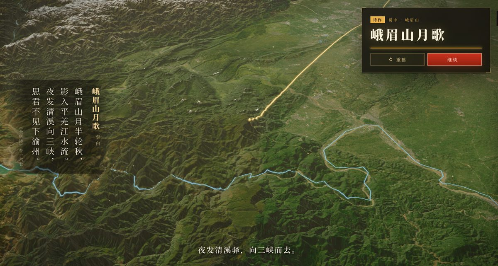
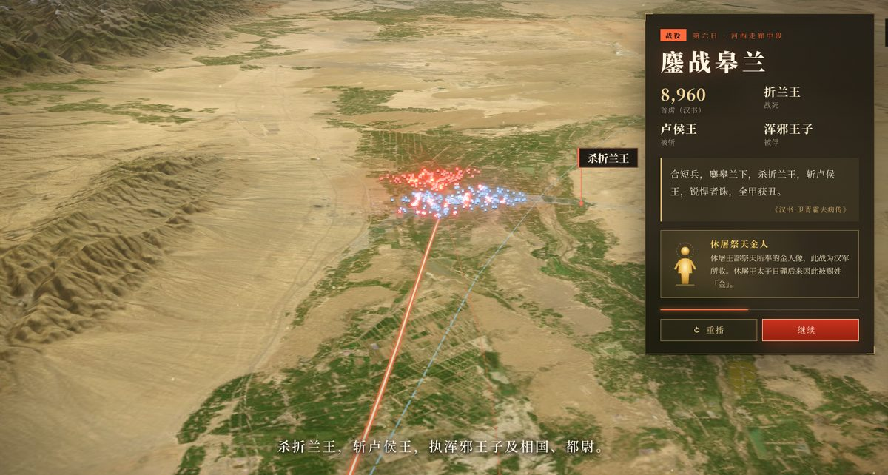
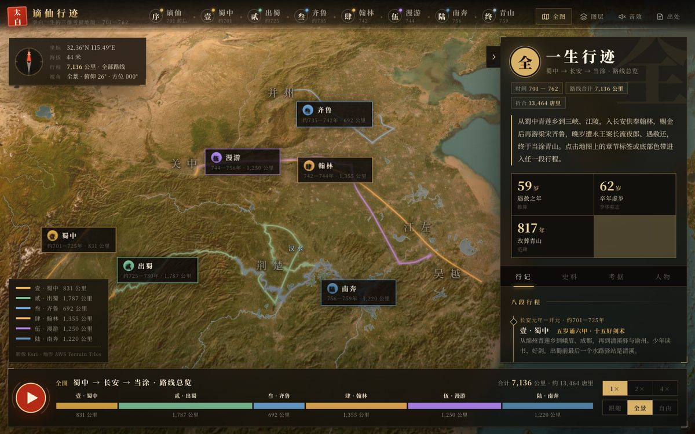
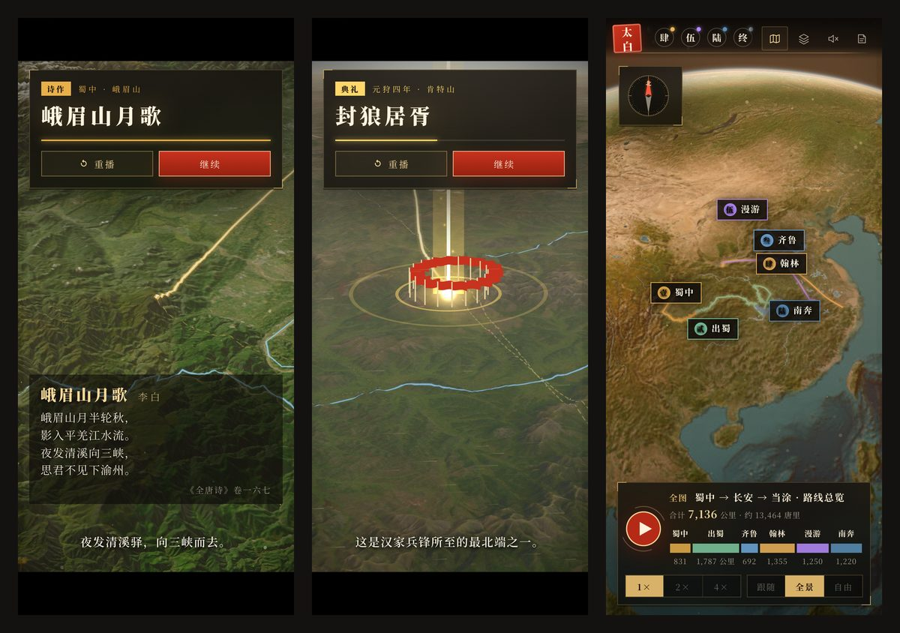

# history-map3d · 人物行迹三维考据地图

输入一个历史人物的名字，让 AI 照史料做出他一生行迹的三维地图网站：在三维地形和卫星影像上按时间走一遍行程，路过关键地点时演出场景（字幕、诗卡、特效、合成音效），每个年份、数字、引文都标了出处。



| 战役演出（霍去病） | 一生行迹总览（李白） | 手机 |
|---|---|---|
|  |  |  |

**在线示例**

- 李白 · 谪仙行迹：<https://libai.zhanglearning.com>
- 霍去病 · 封狼居胥：<https://huoqubing.zhanglearning.com>（线上版多一层汉匈疆域图，疆域数据的许可不允许再分发，仓库里的范例去掉了这一层）

## 它怎么工作

模型只写两样东西：`research/` 里的考据笔记（Markdown）和 `story/` 里的数据（JSON）。其余都已经写好：

| 部分 | 做什么 |
|---|---|
| `engine/` | 静态网页引擎：MapLibre GL 三维地球 + 地形 + 卫星影像，Canvas 特效，Web Audio 合成音效，手机竖屏适配 |
| `scripts/check.py` | 查数据：字数上限、坐标、路线、出处、数字有没有记账、禁用句式，每条报警都带「怎么改」 |
| `scripts/geo.py` | 算路线：沿河道走、海拔、里程；核对坐标、查河名 |
| `scripts/build.py` | 生成网站：检查 → 地理数据 → 嵌入字体子集 → `dist/` |
| `scripts/shoot.py` | 截图查版面：电脑和手机逐个画面截图，自动找出遮挡、溢出、折行、看不见的演出 |
| `references/` | 数据格式、场景写法、考据规矩、看图清单 |
| `examples/` | 两个完整范例：李白（文人、诗作、舟行）、霍去病（武将、战役） |

每一步都有一条验收命令，报警照「怎么改」改到 0，能力一般的模型也能收敛到能交付的结果。

## 准备环境

需要 Python 3.9 以上，能联网（地形和影像瓦片在网上）。

```bash
git clone https://github.com/tjxj/history-map3d.git
cd history-map3d
python3 -m pip install -r requirements.txt
python3 -m playwright install chromium
python3 scripts/doctor.py
```

`doctor.py` 逐项检查依赖、截图浏览器、字体和网络，缺什么给出安装命令。

字体可选：网页默认用思源宋体，从 [adobe-fonts/source-han-serif](https://github.com/adobe-fonts/source-han-serif) 下载简体可变字体 `SourceHanSerifSC-VF.ttf`，放进仓库的 `fonts/` 文件夹（或设环境变量 `HMAP_FONT=字体路径`）。build.py 只嵌入页面用到的字，通常一两百 KB。没有这个字体，网页用系统宋体。

## 用法

### 一、当 Agent Skill 用

把仓库放进 agent 的 skills 目录。以 Claude Code 为例：

```bash
git clone https://github.com/tjxj/history-map3d.git ~/.claude/skills/history-map3d
```

然后在任意文件夹打开 Claude Code，说：

> 做一个苏轼的三维考据地图

或者输入 `/history-map3d 苏轼`。agent 会读 [SKILL.md](SKILL.md)，在当前文件夹新建项目，从考据做到截图查版面，部署前停下来问你。

其他支持 Agent Skills（`SKILL.md`）的工具，放进它们的 skills 目录即可。

### 二、任意编程 Agent 打开仓库

用 Codex、Cursor、Gemini CLI、Claude Code 等打开仓库文件夹，说「做苏轼」。agent 读 [AGENTS.md](AGENTS.md)，项目建在 `projects/sushi/`（不进 git）。

### 三、能力较弱的模型分阶段做

[prompts/stages.md](prompts/stages.md) 把全程拆成八段提示词，每段开一个新对话，你看过一段的清单再发下一段。适合各家的 flash、mini 系列模型。

### 四、自己动手

```bash
python3 scripts/new.py projects/sushi 苏轼 --seal 东坡     # 新建项目（模板本身就能构建）
python3 scripts/check.py projects/sushi --stage 1          # 阶段验收
python3 scripts/build.py projects/sushi                    # 检查 + 生成网站
python3 scripts/shoot.py projects/sushi                    # 截图查版面
python3 -m http.server 8000 -d projects/sushi/dist         # 本地预览 http://localhost:8000
```

## 八个阶段

| 阶段 | 产出 | 验收 |
|---|---|---|
| 1 资料 | `research/` 年表、地点坐标、数字台账、原文摘录、争议 | `check.py --stage 1` |
| 2 大纲 | `research/outline.md`：5–9 章，每章路线和场景，都有出处 | `check.py --stage 2` |
| 3 地理 | 地点、路线、地图大字、底图参数 | `check.py --stage 3` |
| 4 骨架 | 全部章节文件，全站设置 | `build.py` 0 错误 |
| 5 充实 | 每章数字卡、经过、时间线、史料、考据、人物、1–3 个场景 | `build.py` 0 错误 0 警告 |
| 6 版面 | 截图修版面 | `shoot.py` 0 错误 0 警告 |
| 7 审校 | 逐条对照考据笔记 | `build.py` 0 错误 0 警告 |
| 8 部署 | 上线 | 先问人，确认后再发布 |

## 引擎能演什么

- **场景类型**：诗作、舟行、相会、风景、事件、典礼、战役、受降、同一时刻
- **特效**：脉冲光圈、包围圈、光柱、大字横幅、文字、人或小舟移动、逃离、沿路线护送、旗、旗阵、箭雨、交锋火花、受降变色、沙暴
- **兵力符号**：楔形、横列、一团、营地、环形、单人，可以对冲、近战、溃逃、追击、迁徙、受降
- **天气**：沙尘、雪、飞絮、热浪、落叶、草屑、火星、雨丝、雾团、花瓣、萤光、沙暴
- **合成音效**：古琴、钟、埙、风、水、鼓、号角、马蹄、兵刃、箭雨、呐喊等 16 种，全部实时合成，没有音频文件
- **资料面板**：每章的经过、时间线、史料原文、异文对照、考据（各家说法，点一下地图飞到对应地点）、人物

写法见 [references/scenes.md](references/scenes.md)，数据格式见 [references/spec.md](references/spec.md)。

## 部署

`dist/` 是纯静态网站，放到任何静态托管都行：Cloudflare、GitHub Pages、Netlify、Vercel、自己的服务器。用 Cloudflare 时，在项目里写 `wrangler.jsonc`：

```jsonc
{"name": "sushi-map3d", "compatibility_date": "2026-11-01", "assets": {"directory": "./dist"},
 "routes": [{"pattern": "sushi.example.com", "custom_domain": true}], "workers_dev": false, "preview_urls": false}
```

再运行 `npx wrangler deploy`。

## 目录

```text
history-map3d/
├── SKILL.md            Agent Skill 入口：八个阶段的流程和规矩
├── AGENTS.md           在仓库里直接用时给 agent 的说明
├── prompts/stages.md   分阶段提示词
├── references/         数据格式、场景写法、考据规矩、看图清单
├── engine/             网页引擎（HTML / CSS / JS，内含 MapLibre GL JS 5.24）
├── scripts/            doctor、new、check、geo、build、shoot
├── templates/starter/  新项目模板
├── examples/           李白、霍去病两个完整范例
└── data/ne/            Natural Earth 河流、湖泊、地理区域
```

缓存默认在 `~/.cache/history-map3d`（高程瓦片、字体子集、截图用的地图瓦片），可以随时删。环境变量：`HMAP_CACHE` 改缓存位置，`HMAP_FONT` 指定字体文件。

## 常见问题

**截图里地图是黑的或空白。** 先确认能联网；再加 `--soft-gl` 用软件渲染重拍。

**路线报「河在两点之间不连通」。** Natural Earth 的河道有断开的地方。在断口两侧各加一个点，或改走陆路拐点。

**能做外国人物吗？** 地形、影像、河流湖泊都是全球数据，坐标在哪都能画。界面文字和检查规则是按中文写的。

**想换卫星影像源。** 改 `engine/js/app.js` 里的 `SAT` 瓦片地址，并在 site.json 的 `credits` 里写明来源。

**Windows。** 把命令里的 `python3` 换成 `python`；路径有空格要加引号。

## 许可

代码以 [MIT](LICENSE) 发布。第三方数据和组件（MapLibre GL JS、Natural Earth、地形瓦片、Esri 影像、思源宋体）各有许可，见 [THIRD_PARTY.md](THIRD_PARTY.md)。范例里的史料原文、诗文出自公版古籍。
